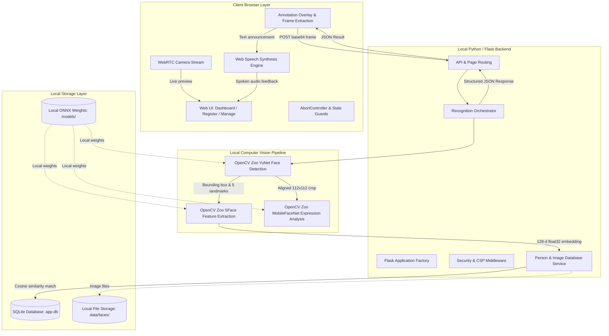
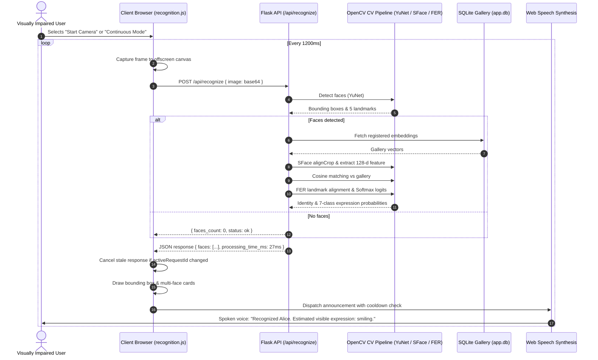
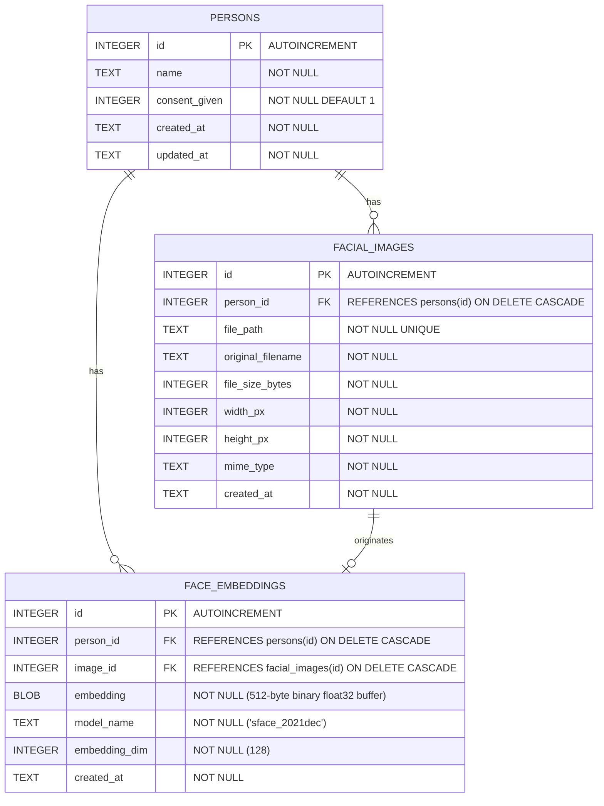

# System Architecture: AI Person and Facial Expression Recognition

This document provides a comprehensive architectural description of the **AI-Based Person and Facial Expression Recognition** assistive system. The application operates **100% locally on CPU** without sending images, embeddings, or audio to any external cloud or AI services.

---

## 1. High-Level Architecture Overview

---

## 2. Core Components and Responsibilities

### 2.1 Frontend Client (`app/static/`)
- **`camera.js` (WebRTC Hardware Isolation):**
  - Manages webcam stream lifecycle (`getUserMedia`, play, pause, release tracks).
  - Preserves strict hardware boundary: never performs network calls, canvas frame grabbing, or speech synthesis.
- **`recognition.js` (Assistive Client & Audio Dispatcher):**
  - Grabs video frames onto an offscreen canvas at controlled 1200ms intervals.
  - Implements single-flight request backpressure using `AbortController` and an incrementing `activeRequestId` to cancel in-flight network requests and reject stale out-of-order responses.
  - Draws color-coded bounding boxes on the canvas overlay (Green = Recognized, Amber = Uncertain, Red = Unknown).
  - Dispatches natural-language spoken announcements via the browser `window.speechSynthesis` API (`SpeechSynthesisUtterance`).
  - Enforces duplicate speech suppression, cooldown intervals (4s, 6s, 10s), voice mute toggle, and manual repeat controls.
  - Renders multi-face breakdown cards showing individual face coordinates, identity match scores, and expression estimates.
- **`register.js` & `manage.js`:**
  - Client-side form validation, informed consent verification, profile editing, and deletion.

### 2.2 Flask Application Server (`app/`)
- **Application Factory (`create_app` in `app/__init__.py`):**
  - Initializes application context, routes, SQLite database, error handlers, and security headers.
- **Security Middleware (`app/security.py`):**
  - Injects strict Content Security Policy (`script-src 'self'`, `default-src 'self'`, `media-src 'self' blob:`, `connect-src 'self'`).
  - Sets `Permissions-Policy: camera=(self), microphone=(), geolocation=()`.
  - Enforces `Cache-Control: no-store` on all dynamic routes and API responses.
- **Routing Layer (`app/routes/`):**
  - `pages.py`: Server-rendered Jinja2 views for `/` (Dashboard), `/register` (Registration), and `/manage` (Profile Directory).
  - `api.py`: JSON endpoints for `/api/health`, `/api/persons` CRUD, `/api/persons/<id>/image` (protected serving), and `/api/recognize`.

### 2.3 Computer Vision & ML Subsystems (`app/services/`)
- **Face Detector (`app/services/face_detector.py`):**
  - Implements OpenCV Zoo YuNet (`cv2.FaceDetectorYN`) in ONNX format (`face_detection_yunet_2023mar.onnx`).
  - Detects single and multiple faces, returning bounding box `[x, y, w, h]`, confidence score, and 5 facial landmarks (right eye, left eye, nose tip, right mouth corner, left mouth corner).
- **Face Recognizer (`app/services/face_recognizer.py`):**
  - Implements OpenCV Zoo SFace (`cv2.FaceRecognizerSF`) in ONNX format (`face_recognition_sface_2021dec.onnx`).
  - Aligns face crops using the 5 detected landmarks (`alignCrop`) and extracts 128-dimensional L2-normalized float32 feature embeddings (`feature`).
  - Computes cosine similarity against registered gallery representations (`compute_similarity`).
  - Threshold rule: $\ge 0.363$ &rarr; Recognized, $0.300 \dots 0.363$ &rarr; Uncertain, $< 0.300$ &rarr; Unknown.
- **Facial Expression Classifier (`app/services/expressions.py`):**
  - Implements OpenCV Zoo MobileFaceNet (`cv2.dnn.readNetFromONNX`) in ONNX format (`facial_expression_recognition_mobilefacenet_2022july.onnx`).
  - Performs 5-point landmark similarity affine warping to standard $112 \times 112$ anchor coordinates (`cv2.estimateAffinePartial2D`).
  - Classifies into 7 universal categories: `angry`, `disgust`, `fearful`, `happy`, `neutral`, `sad`, `surprised`.
  - Converts raw logits to calibrated probabilities via Softmax ($P(c) = \frac{e^{z_c}}{\sum_k e^{z_k}}$).
  - Handles uncertainty (flags `uncertain` if top probability $< 0.45$) and degraded images (< 24px flags `unusable`).
  - Operates completely independently from identity recognition.
- **Recognition Orchestrator (`app/services/recognition_service.py`):**
  - Coordinates detection, gallery retrieval, identity matching, and expression analysis into a structured JSON payload with execution latency metrics.

---

## 3. Data Flow Diagram

---

## 4. API Endpoints Specification

| Method | Endpoint | Description | Request Payload | Response Schema |
| :--- | :--- | :--- | :--- | :--- |
| `GET` | `/api/health` | System health, version, phase, and capabilities | None | `{"status": "ok", "app": "...", "version": "1.0.0", "phase": 7, "capabilities": {...}}` |
| `GET` | `/api/persons` | List registered profiles with optional `?q=` search | Query params | `{"status": "ok", "count": N, "persons": [...]}` |
| `POST` | `/api/persons` | Register a new person with photo and consent | `multipart/form-data` (name, photo, consent) | `{"status": "ok", "person": {"id": 1, "name": "..."}}` |
| `GET` | `/api/persons/<id>` | Retrieve profile by ID | None | `{"status": "ok", "person": {...}}` |
| `PUT` | `/api/persons/<id>` | Update person name | `{"name": "New Name"}` | `{"status": "ok", "person": {...}}` |
| `POST` | `/api/persons/<id>/image` | Replace person reference image & recompute embedding | `multipart/form-data` (photo) | `{"status": "ok", "person": {...}}` |
| `DELETE` | `/api/persons/<id>` | Delete person, disk photos, and face embeddings | None | `{"status": "ok", "message": "..."}` |
| `GET` | `/api/persons/<id>/image` | Serve protected facial photo | None | Binary image (`image/jpeg`, `Cache-Control: no-store`) |
| `POST` | `/api/recognize` | Perform face detection, identity matching, and FER | `{"image": "data:image/jpeg;base64,..."}` | `{"status": "ok", "faces_count": N, "faces": [...], "processing_time_ms": 26.7}` |

---

## 5. Database Schema

Stored in local SQLite database (`data/app.db`) with foreign key constraints and cascade deletion enabled:

---

## 6. Error-Handling and Graceful Degradation

1. **Hardware Access Errors:**
   - Handled gracefully in `camera.js` with human-readable error banners for `NotAllowedError` (blocked permission), `NotFoundError` (unplugged camera), and `NotReadableError` (camera busy in another app).
2. **Missing AI Model Weights:**
   - Handled via `ModelNotLoadedError` with clear operational diagnostics without crashing the Flask worker.
3. **No Faces in Frame:**
   - Responds with `faces_count: 0` without raising an error. The client announces "No faces detected in view" once upon scene departure.
4. **Poor Quality / Small Face Crops (< 24px):**
   - Flagged with status `"unusable"`, bypassing expression inference to avoid hallucinated predictions.
5. **Low Identity Confidence (0.300 to 0.363):**
   - Categorized as `"uncertain"`. The voice synthesis communicates "Person not identified with confidence. Please try again" rather than falsely guessing an identity.
6. **Network Request Aborts & Tab Unload:**
   - When continuous recognition is stopped or the tab unloads, `activeAbortController.abort()` cleanly cancels in-flight fetches, and `window.speechSynthesis.cancel()` immediately halts queued speech.
